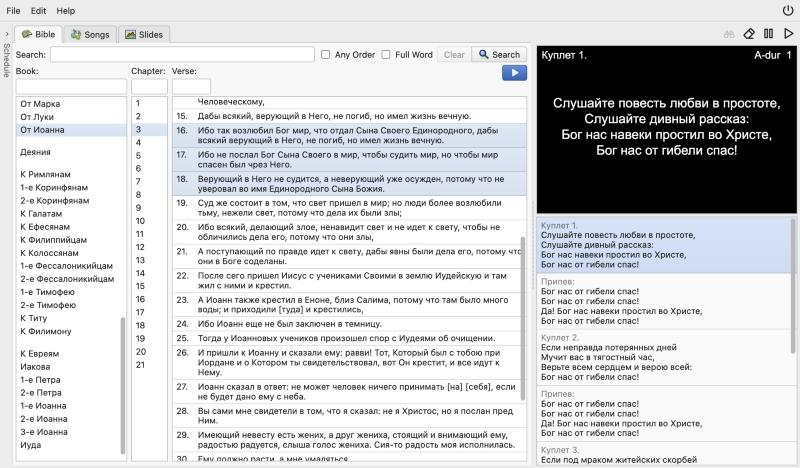

# Word Projector

Church projection software to display Bible, Songs, or Slide shows on one or more screens. A vibecode rewrite of [SoftProjector](http://softprojector.org) using Go/React for macOS, Windows and Linux.

<p align="center">
  
</p>

## Install

Download the latest release from [Releases](../../releases) and unpack it.
Nothing else needs installing.

| System                | File                                         |
|-----------------------|----------------------------------------------|
| macOS (Apple Silicon) | `WordProjector-<version>-macos-arm64.zip`    |
| macOS (Intel)         | `WordProjector-<version>-macos-x64.zip`      |
| Windows (arm64)       | `WordProjector-<version>-windows-arm64.zip`  |
| Windows (x64)         | `WordProjector-<version>-windows-x64.zip`    |
| Linux (arm6)          | `WordProjector-<version>-linux-arm64.tar.gz` |
| Linux (x64)           | `WordProjector-<version>-linux-x64.tar.gz`   |

Starting it:

* **macOS**: move **Word Projector** to Applications and open it.
* **Windows**: run `WordProjector.exe`.
* **Linux**: run `./WordProjector` (needs `libwebkit2gtk-4.1-0`).

After that you can update/downgrade or configure auto-upate in **Settings → Updates**.

You can download Bibles and Songbooks from **Edit → Books → Import from Cloud** (hosted by SoftProjector team), or import
your own files directly.

## Your data

Database, downloaded books and the log live here:

* macOS: `~/Library/Application Support/WordProjector`
* Windows: `%APPDATA%\WordProjector`
* Linux: `~/.local/share/WordProjector`

Use another folder with `--data <folder>`, or put `wordprojector.sqlite` next to the
program for a portable copy.

## Using it

* One screen: the presentation covers it when something is shown. With more
  screens, each can show its own projector window.
* Any browser can be a display or a remote: turn on **Settings → Remote → Enable Public Access** and open `http://<computer>:<port>/`.
* Run without windows, as a web server only:
  `WordProjector --headless --listen 0.0.0.0:8777`.

## Build from source

You need Go 1.26+ and Node 22+. Linux also needs
`libgtk-3-dev libwebkit2gtk-4.1-dev`; macOS needs the Xcode command line tools.

```bash
make build      # frontend + bin/wordprojector
make test
make dev        # Go API on :8777, Vite on :5173
make install    # macOS: build and install the app into /Applications
```